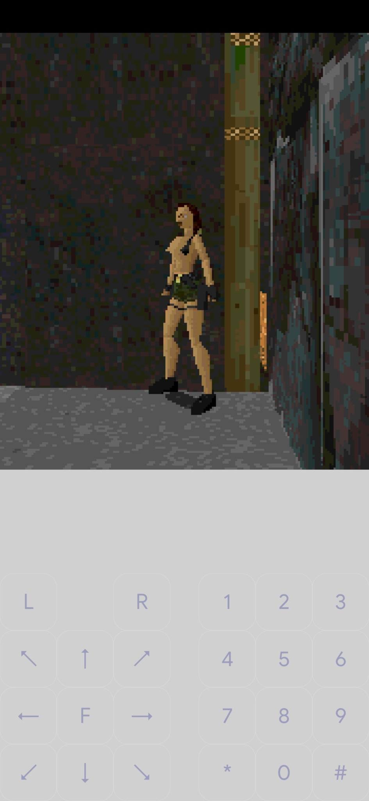
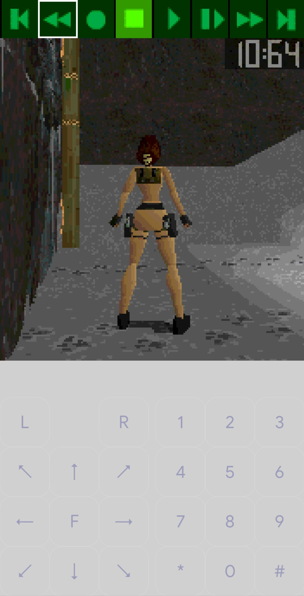
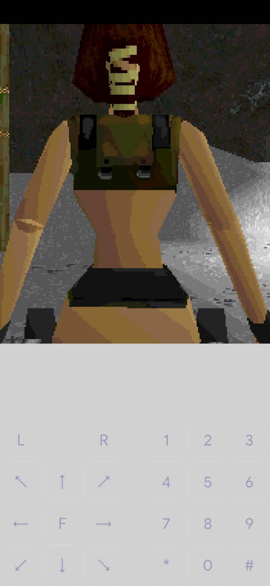

# Body / accessory separation — the two diagnostic tests

This document records the two contrast tests that established how the N-Gage Lara editor should separate **body**, **clothing/pants**, and **accessories**.

Both tests were run against the same stock AoD outfit mapping. They are included under:

```text
examples/01_arm_body_contrast/
examples/02_pants_belt_isolation/
```

Each example contains an `INSTALL/` folder with the modified `retexture.dat`, the generated mesh/UV reference, manifests, changed-face tables, and the captured in-game screenshots. The unchanged stock AoD `new_tpage.tpa` is not bundled; use your own copy or regenerate the example from original inputs.

## The key lesson

A Lara **mesh object** and a Lara **texture region** are not the same thing.

The pelvis is one mesh object:

```text
mesh 0 = pelvis
```

but that mesh contains many independently textured polygons. The shorts/pants body and the upper waistband/belt therefore do **not** need to be treated as one indivisible visual region.

For an editor, this means:

```text
mesh-level selection       too coarse for some jobs
face/descriptor selection  separates belt from shorts
pixel/atlas editing        changes the artwork inside those mappings
```

This distinction is important. The successful belt-isolation test did **not** require changing Lara's geometry. It changed the **texture assignment of selected pelvis faces** while preserving the belt faces. If a future outfit stores belt and shorts inside the same actual atlas region or palette group, then the atlas pixels/descriptors themselves also have to be edited or split.

---

## Example 1 — Arm / Body Contrast

Purpose: make Lara's main body visually uniform so accessories stand out.

The test reused Lara's existing arm/skin descriptor:

```text
local texture code 18
```

and assigned it to:

```text
torso/top body faces
left/right thigh faces
left/right calf faces
```

The **pelvis mesh was intentionally left untouched**.

Result: the torso and legs became skin-toned, but the original green shorts on the pelvis remained. Because the shorts still occupied the waist area, they visually obscured the belt separation.



What this proved:

```text
changing the main body texture assignment works
arms / torso / leg regions can be made visually consistent
accessories remain easy to identify
BUT leaving the pelvis as one untouched object leaves the shorts in place
```

Included modified file:

```text
examples/01_arm_body_contrast/INSTALL/retexture.dat
```

The texture page required by this diagnostic is the unchanged stock AoD page (not included). The visible result comes from changed face assignments in `retexture.dat`.

---

## Example 2 — Pants + Belt Isolation

The second test addressed the pelvis directly.

Instead of treating mesh 0 as one visual block, the pelvis faces were divided into two groups.

### Main shorts/pants faces remapped to the arm/skin descriptor

```text
0, 1, 2, 3, 4, 5,
8,
10, 11, 12, 13, 14, 15,
18, 19, 20, 21
```

### Upper waistband/belt faces preserved

```text
6, 7, 9, 16, 17, 22, 23
```

This produced the intended visual separation: the pelvis/pants body became skin-toned while the dark belt remained visible.



The close-up makes the result particularly clear:



What this proved:

```text
pelvis = one mesh object
pelvis != one texture assignment

individual pelvis faces can keep different descriptors
belt can remain separate from the pants/body
no geometry edit is required for this separation
```

Included modified file:

```text
examples/02_pants_belt_isolation/INSTALL/retexture.dat
```

Again, use your own unchanged stock AoD `new_tpage.tpa`. The separation is produced by the modified `retexture.dat` mapping.

---

# Why this matters for the texture editor

The editor should eventually expose **named visual groups** rather than forcing the user to reason in raw face numbers.

A useful future view would be:

```text
BODY
  torso body
  pelvis body / shorts
  thighs
  calves
  arms

ACCESSORIES
  belt / waistband
  backpack
  holsters
  boots
  gloves / hands where applicable
  head / hair
```

The first named mapping is stored in:

```text
presets/aod_body_accessory_groups.json
```

This is deliberately a reference/preset for the known stock AoD mapping. It is hash-bound to the analyzed files so it cannot silently be applied to an unrelated custom outfit.

---

# Texture edit vs. texture assignment

There are two different operations a modder may perform:

### 1. Change which texture a polygon uses

This is what the two examples above do.

```text
polygon / face
   ↓
retexture.dat local code
   ↓
different descriptor / UV / palette selection
```

It is ideal for diagnostics and for separating polygons that already exist independently.

### 2. Change the pixels inside the texture

This is the normal v0.2 no-WAD editor workflow:

```text
new_tpage.tpa + retexture.dat
   ↓
Export Editable Texture
   ↓
texture_edit.png
   ↓
paint body / belt / fabric / accessories
   ↓
Import Edited Texture
   ↓
new_tpage.tpa
```

If two visual elements share the same descriptor/palette/atlas pixels, changing the assignment alone cannot give both of them unique artwork. At that point the texture itself must be edited, or the descriptor layout must be split so each region receives its own editable patch.

The belt experiment therefore gives us a concrete editor-design rule:

> **Do not equate one mesh with one editable material. The editor needs face/descriptor-aware regions, with pixel editing layered on top.**

---

# Reproduce the examples from the tool

v0.2.1 adds a CLI command and an **Examples** GUI tab.

Example 1:

```bash
python3 tr_ngage_outfit.py make-example arm-body-contrast new_tpage.tpa \
  --retexture retexture.dat \
  --lara-mesh lara.mesh \
  -o Example1
```

Example 2:

```bash
python3 tr_ngage_outfit.py make-example pants-belt-isolation new_tpage.tpa \
  --retexture retexture.dat \
  --lara-mesh lara.mesh \
  -o Example2
```

For safety, these presets require the exact stock AoD reference hashes used during reverse engineering. They will refuse to run against a different custom outfit.
