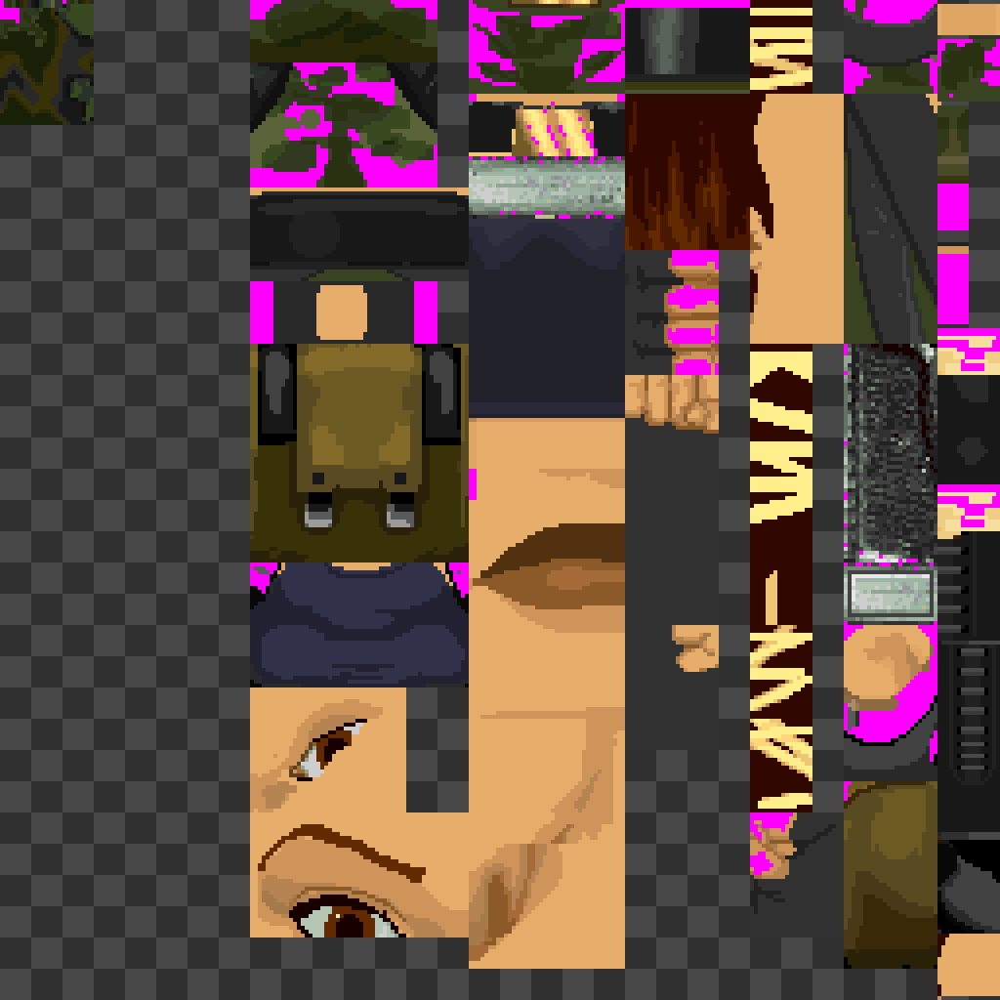
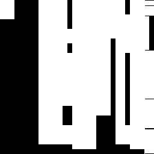
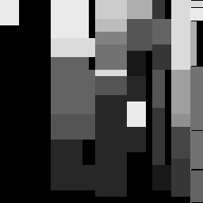

# TR N-Gage Outfit Tool v0.3.0 — Editable Texture Workflow

This document explains the **WAD-independent texture editing workflow** in TR N-Gage Outfit Tool v0.2.

The important idea is simple:

> **A WAD is useful for creating a new outfit layout, but it is not required for ordinary texture editing once a valid N-Gage outfit already exists.**

If you already have a working set of:

```text
new_tpage.tpa
retexture.dat
lara.mesh
```

then the tool can export the outfit to a normal **256×256 PNG/BMP**, let you edit it in Photoshop, GIMP, Krita, Paint.NET, Affinity Photo, etc., and then rebuild valid N-Gage files.

The tool keeps the existing Lara geometry, UV layout, texture descriptors, and face assignments. It only rebuilds the texture page and palettes from your edited artwork.

---

## 1. What each N-Gage file does

The outfit system we reverse engineered is split across three files.

### `new_tpage.tpa`

This is the actual custom Lara texture page.

It is:

```text
32,768 bytes
256 × 256 texture pixels
4 bits per pixel
16 palette entries per palette group
```

Internally it is uploaded into the PlayStation-style VRAM layout used by the N-Gage port.

The texture page begins at approximately:

```text
VRAM X = 192
VRAM Y = 256
```

The pixel values are **indices**, not direct RGB colors. Each pixel is only 4 bits, so it selects one of 16 colors from a CLUT/palette.

### `retexture.dat`

This file tells the game how Lara's polygons use the custom page.

It contains:

```text
101 × 16-byte descriptor table A
101 × 16-byte descriptor table B
629 Lara face patch records
```

Total size:

```text
9,006 bytes
```

The descriptors contain UV coordinates, palette/CLUT selection, and the texture-page information used by Lara's polygons.

For the normal texture-editing workflow, **the tool preserves this mapping**. You do not need to understand or manually edit `retexture.dat`.

### `lara.mesh`

This contains Lara geometry used by the N-Gage retexture system, including the 15 main body meshes plus weapon-specific variants.

For normal texture editing:

> **`lara.mesh` is used only as a reference so the tool knows which descriptors/faces are active. It is not modified.**

Geometry replacement is a separate, more advanced feature.

---

## 2. Why a WAD is not required

A WAD was useful during our first experiments because it gave us a source model, textures, UVs, and face assignments from another Tomb Raider build.

For example, the successful early-beta Lara conversion followed this path:

```text
TR1 beta .wad
      ↓
extract Lara texture pieces
      ↓
match Lara faces to N-Gage Lara
      ↓
create a new N-Gage atlas
      ↓
generate new_tpage.tpa
      ↓
generate retexture.dat
```

That is necessary when the tool needs to **invent a new N-Gage texture layout from another game's/model's assets**.

But once an N-Gage outfit already works, the mapping already exists:

```text
lara.mesh
    +
retexture.dat
    +
new_tpage.tpa
        ↓
known working outfit layout
```

The tool can therefore export that existing layout directly to an editable image.

The new workflow is:

```text
existing N-Gage outfit files
        ↓
Export Editable Texture
        ↓
texture_edit.png
        ↓
Photoshop / GIMP / Krita / etc.
        ↓
Import Edited Texture
        ↓
new_tpage.tpa
retexture.dat
```

No WAD is involved.

This means you can design completely original recolors, shirts, pants, skin details, logos, hair colors, tattoos, damage effects, camouflage, costumes, and other texture changes directly in a normal photo editor.

---

## 3. Export an existing N-Gage outfit

### GUI

Open the tool and choose the **Texture Edit** section.

Select:

```text
new_tpage.tpa
retexture.dat
lara.mesh
```

Choose an empty workspace folder and click:

```text
Export Editable Texture
```

### Command line

```bash
python3 tr_ngage_outfit.py export-textures new_tpage.tpa \
    --retexture retexture.dat \
    --lara-mesh lara.mesh \
    -o MyOutfitWorkspace
```

The generated workspace contains files such as:

```text
texture_edit.png
texture_edit.bmp
texture_edit_4x.png
coverage_mask.png
palette_group_map.png
descriptor_layout.csv
palette_map.bin
texture_reference.rgb
template_new_tpage.tpa
template_retexture.dat
workspace.json
README-EDIT-TEXTURES.txt
```

### `texture_edit.png`

This is the image you normally edit.

It is always:

```text
256 × 256 RGB
```

Do **not** resize, crop, rotate the whole canvas, or change its dimensions.



### `coverage_mask.png`

White areas are the rectangular descriptor regions participating in the current outfit mapping. For triangle descriptors, part of the white bounding rectangle can lie outside the actual triangle.

Black areas are outside the current editable mapping.



You can paint in the black regions if you want, but those pixels will not appear in-game unless the UV/descriptor layout is later changed.

### `palette_group_map.png`

This shows how the current outfit is divided into independent 4-bit palette groups.



The colors in this diagnostic image are not Lara colors. Each distinct diagnostic color identifies one 16-color CLUT group.

---

## 4. The palette limitation — with a practical example

The N-Gage outfit page is **4-bpp indexed color**.

That means one texture region cannot simply use unlimited RGB colors like a modern PNG.

Each active palette group has:

```text
16 total entries
```

The convention used by the tool is:

```text
index 0  = transparent
indices 1–15 = up to 15 visible colors
```

So a given group effectively has a maximum of **15 opaque colors plus transparency**.

### You do not have to manually reduce the image to 16 colors

This is important.

You can paint normally in full RGB in Photoshop/GIMP/etc.

For example, suppose you paint a shirt using:

```text
light blue
medium blue
dark blue
white stitching
black shadows
red logo
skin overlap
several anti-aliased shades
```

You might end up with hundreds of RGB values in the PNG.

When importing, the tool automatically:

1. finds all edited pixels belonging to that palette group;
2. converts them to the PSX/N-Gage 5-bit-per-channel color space;
3. builds a new palette with up to 15 opaque representative colors;
4. maps every source pixel to the closest palette entry;
5. writes the 4-bit pixel indices back into `new_tpage.tpa`;
6. writes the CLUT directly into the TPA's embedded palette area.

So the photo editor can stay RGB-based. The tool handles the hardware palette conversion.

### Example: our magenta torso hardware test

Before making the beta Lara outfit, we performed a very simple diagnostic test.

We changed one of Lara's clothing palette groups so most of its visible palette entries became bright magenta.

The affected CLUT rows were:

```text
normal/Table A:     VRAM Y = 500
alternate/Table B:  VRAM Y = 436
```

Those are the same palette group in the two descriptor banks.

On actual N-Gage hardware, Lara's torso immediately became bright magenta while unrelated body areas stayed normal.

That proved this chain:

```text
Lara polygon
    ↓
retexture.dat descriptor
    ↓
palette group / CLUT address
    ↓
embedded palette in new_tpage.tpa
    ↓
visible torso color on hardware
```

This is the same mechanism used by the v0.2 texture editor, except the tool now rebuilds those palettes automatically from a normal RGB image.

---

## 5. Where the palettes physically live

`new_tpage.tpa` is not just pixel indices. It also contains the CLUT data inside unused portions of the uploaded texture page.

The normal descriptor bank uses approximately:

```text
Table A / normal-looking palettes
VRAM X = 192
VRAM Y = 497–511
```

Because the TPA starts at VRAM Y=256, those are local TPA rows:

```text
241–255
```

The alternate descriptor bank uses:

```text
Table B / alternate or underwater-looking palettes
VRAM X = 192
VRAM Y = 433–447
```

which corresponds to local TPA rows:

```text
177–191
```

There are up to 15 palette groups in each bank.

The exact gameplay meaning of the second bank is still being treated conservatively as an **alternate/underwater-looking palette bank**, but its visual output strongly resembles the game's underwater tinting.

---

## 6. Transparency

The editable workspace uses pure magenta as the transparency key:

```text
RGB 255, 0, 255
#FF00FF
```

Inside a **used** texture region, a pure magenta pixel is converted to palette index 0.

Therefore:

```text
#FF00FF → transparent
```

Do not use exact `255,0,255` as a visible pink color unless you intentionally want transparency.

If you need a visible magenta, use a slightly different value, for example:

```text
RGB 250, 0, 250
```

or another nearby shade.

The export command can also use another transparency key with `--transparent` if necessary.

---

## 7. Editing rules

For reliable results:

### Keep the image exactly 256×256

Do not:

```text
resize
crop
change canvas size
rotate the entire atlas
move all artwork relative to the atlas
```

The UV coordinates in `retexture.dat` still point to the existing positions.

### You may freely repaint inside the used regions

You can change:

```text
colors
clothing patterns
logos
skin tones
hair colors
shading
face details
tattoos
damage/blood effects
camouflage
fabric details
```

as long as the artwork remains where the existing UVs expect it.

### Anti-aliasing is allowed

The source PNG may contain smooth RGB transitions. The importer will quantize them to the hardware palette.

Extremely subtle gradients may lose detail because only 15 visible colors are available per group.

### Avoid painting across unrelated palette regions without checking the map

Two adjacent areas in the PNG can belong to different CLUT groups. The tool quantizes each group independently.

Use:

```text
palette_group_map.png
```

when you need to understand those boundaries.

---

## 8. Import the edited texture

When you are finished editing, save the file as either:

```text
PNG — preferred
BMP — supported
```

PNG must remain a normal non-interlaced RGB/RGBA image. BMP can be uncompressed 24-bit or 32-bit.

### GUI

Choose:

```text
workspace folder
edited image
output folder
```

then click:

```text
Import Edited Texture
```

### Command line

If you edited the original `texture_edit.png` in place:

```bash
python3 tr_ngage_outfit.py import-textures MyOutfitWorkspace \
    -o MyEditedOutfit
```

Or specify another image:

```bash
python3 tr_ngage_outfit.py import-textures MyOutfitWorkspace \
    --image MyCustomLara.png \
    -o MyEditedOutfit
```

The output contains:

```text
new_tpage.tpa
retexture.dat
imported_preview.png
imported_preview_4x.png
import_manifest.json
INSTALL.txt
```

The rebuilt `retexture.dat` is the matching workspace template and therefore retains the same UV/face layout.

---

## 9. Alternate palette mode

The importer supports two behaviors for descriptor Table B.

### Recommended: `duplicate`

```bash
--alternate-mode duplicate
```

The newly generated normal palettes are copied into the alternate bank too.

This is the safest option for a newly painted outfit because Lara will not unexpectedly switch back to old AoD colors when the game selects the alternate palette bank.

Example:

```bash
python3 tr_ngage_outfit.py import-textures MyOutfitWorkspace \
    --image MyCustomLara.png \
    --alternate-mode duplicate \
    -o MyEditedOutfit
```

### Advanced: `preserve`

```bash
--alternate-mode preserve
```

This updates the normal palettes but leaves the original alternate CLUT words untouched.

This can be useful later if you deliberately create separate normal and underwater/special palettes, but it may produce mismatched colors if the edited texture is very different from the original.

---

## 10. Install the rebuilt files

**Always back up the originals first.**

Copy:

```text
new_tpage.tpa
retexture.dat
```

to:

```text
E:\System\Apps\tombraider\data\deldata\
```

For this workflow, leave:

```text
lara.mesh
TOMBRAIDER.NAX
```

unchanged.

---

## 11. What happens if you export and import without changing anything?

The tool contains a specific safety path for this.

If the editable RGB image has not changed at all, the importer does **not** unnecessarily requantize it.

Instead it copies the original:

```text
new_tpage.tpa
retexture.dat
```

byte-for-byte.

The included regression test verifies this behavior:

```bash
python3 tests/selftest_texture_workspace.py \
    new_tpage.tpa retexture.dat lara.mesh
```

Expected result:

```text
SELFTEST PASS: editable texture workspace round-trips byte-for-byte with no edits.
```

This software round-trip was tested successfully during v0.2 development. The first deliberately edited no-WAD hardware test is packaged separately for device validation.

---

## 12. What a WAD is still useful for

The WAD-free editor does **not** make WAD conversion obsolete.

A WAD/WAD2 or another model source is still useful when you want to change things that are outside the existing N-Gage layout.

### No WAD needed

These can be done with the editable texture workspace:

```text
recolor existing clothes
new shirt/pants designs
hair recolors
skin recolors
logos
face repainting
tattoos
camouflage
texture restoration
higher-quality hand-painted artwork
```

### WAD/model data is useful or required

These changes require a deeper conversion:

```text
new UV layout
moving texture islands
adding/removing polygons
changing Lara geometry
using a higher-detail TR4/TR5/TEN model
changing mesh topology
creating new weapon-specific meshes
```

A useful way to think about it is:

```text
PHOTO EDITOR WORKFLOW
changes the paint on the existing model

WAD / MODEL CONVERTER
can change how the model itself is constructed and mapped
```

---

## 13. Example workflows

### Example A — recolor AoD Lara without any WAD

Start with the original working AoD files:

```text
new_tpage.tpa
retexture.dat
lara.mesh
```

Export:

```bash
python3 tr_ngage_outfit.py export-textures new_tpage.tpa \
    --retexture retexture.dat \
    --lara-mesh lara.mesh \
    -o AoDEdit
```

Open:

```text
AoDEdit/texture_edit.png
```

Change Lara's shirt from black to blue in Photoshop.

Import:

```bash
python3 tr_ngage_outfit.py import-textures AoDEdit \
    --image AoDEdit/texture_edit.png \
    --alternate-mode duplicate \
    -o AoDBlue
```

Install:

```text
AoDBlue/new_tpage.tpa
AoDBlue/retexture.dat
```

No WAD was involved.

### Example B — use the beta Lara conversion as a new art template

We already generated a working N-Gage beta Lara outfit from the beta WAD.

Once those files exist, the beta WAD is no longer required for repainting it.

Export the working beta outfit:

```bash
python3 tr_ngage_outfit.py export-textures Beta/new_tpage.tpa \
    --retexture Beta/retexture.dat \
    --lara-mesh lara.mesh \
    -o BetaArtWorkspace
```

Now an artist can repeatedly edit:

```text
BetaArtWorkspace/texture_edit.png
```

and rebuild new variants without ever opening or parsing the WAD again.

For example:

```text
Beta Lara — blue shirt
Beta Lara — red shirt
Beta Lara — camouflage
Beta Lara — alternate face
Beta Lara — custom logo
```

all use the same existing N-Gage UV/layout mapping.

---

## 14. Current boundary of the feature

v0.2's WAD-independent texture editor is intentionally conservative.

It changes:

```text
pixel indices
normal palette bank
optionally alternate palette bank
```

It preserves:

```text
lara.mesh geometry
retexture.dat face topology
retexture.dat UV layout
texture descriptor positions
```

That is why it is relatively safe: the game is still reading the same structures that are already known to work on actual N-Gage hardware.

A later geometry/UV editor can build on top of this system.

---

## 15. Short version

If you only remember one thing, remember this:

```text
YOU DO NOT NEED A WAD TO MAKE A NEW TEXTURE OUTFIT.
```

A WAD is only needed when you want the tool to derive a **new mapping/model** from external Tomb Raider assets.

For ordinary custom artwork:

```text
working N-Gage outfit
        ↓
export texture_edit.png
        ↓
edit in Photoshop/GIMP/etc.
        ↓
import image
        ↓
new_tpage.tpa + retexture.dat
        ↓
copy to real N-Gage
```

The importer automatically handles the 4-bpp pixel indices and the 16-color-per-group hardware palettes.

---

# Body vs. accessory editing: pelvis/belt example

A practical limitation of object-level editing became obvious during two contrast tests.

The pelvis is a single Lara mesh object, but it contains multiple independently textured faces. Treating the whole pelvis as one edit target left the shorts unchanged and made the belt hard to distinguish. The follow-up test preserved only the upper waistband/belt faces while remapping the main pelvis/shorts faces, and the belt became clearly visible.

This means the editor should think in layers:

```text
mesh object -> face group -> descriptor/UV -> atlas pixels -> palette group
```

Use object-level selection for broad navigation, but use face/descriptor groups when you need to isolate accessories such as the belt. If the body and accessory truly share the same actual atlas pixels/palette group, then edit the exported texture or split the descriptor layout.

See `BODY-ACCESSORY-SEPARATION.md` and the two `examples/` folders for modified retexture files, stock-texture requirements, and screenshots.
